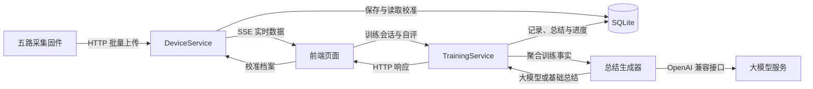

# songxian · 松弦

松弦是一个面向盆底肌训练、坐姿反馈和提肛带练的智能坐垫交互项目。五路压力传感器提供接触与变化数据，电脑服务端负责数据处理和记录，手机浏览器提供校准、带练与反馈界面。

## 功能

- **盆底肌训练**：适用确认、初中高三级课程、收放口令、暂停与重做、练后自评、日历打卡及阶段进度。
- **坐姿反馈**：依据个人参考观察五点接触变化，显示调整建议，并提供语音提示。
- **提肛带练**：独立的五轮收放课程、练后自评与单次总结。
- **设备与校准**：五路实时数据、引导式个人校准、动作示教与验证、断流与饱和检查；未形成有效动作参考时支持计时带练。
- **记录与总结**：本地保存训练完成量、自评和异常统计，支持离线队列同步；可通过大模型整理单次训练事实，未配置或调用失败时使用基础总结。

压力数据用于相对接触与个人模式变化的反馈，不直接测量肌肉活动，也不提供医学诊断。

## 架构

| 部分   | 职责                                         | 主要技术                           |
| ------ | -------------------------------------------- | ---------------------------------- |
| 前端   | 手机交互、校准引导、带练状态、语音及离线队列 | React、TypeScript、Vite、IndexedDB |
| 服务端 | 设备数据处理、校准档案、训练记录、进度与总结 | Fastify、SQLite、Zod               |
| 固件   | 五路压力采集、配网、服务发现和批量上传       | Arduino、ADC、Wi-Fi、HTTP、UDP     |

固件以 50 Hz 采集五路原始值并批量上传。服务端处理设备状态，前端通过 SSE 接收实时数据。训练记录保存聚合指标、自评与异常统计；高频压力流不发送给大模型。训练规则、课程强度和下一步建议由项目自身的规则决定。

## 代码架构

```text
songxian/
├── src/                              # 前端及前后端共享代码
│   ├── main.tsx                      # React 页面入口
│   ├── app/                          # 页面切换与依赖装配
│   ├── contracts/                    # 设备、校准、训练与总结的数据契约
│   ├── domain/                       # 训练状态、课程、校准、坐姿与总结规则
│   ├── application/                  # 应用协调与外部能力接口
│   ├── infrastructure/               # 设备、HTTP、离线存储、音频等适配器
│   ├── features/                     # 训练、坐姿、校准、记录和结果页面
│   ├── shared/                       # 共用界面组件与交互钩子
│   ├── styles/                       # 页面样式
│   └── test/                         # 前端测试配置与测试辅助代码
├── server/
│   ├── index.ts                      # 服务端入口与依赖装配
│   ├── config/                       # 环境配置读取与校验
│   ├── http/                         # HTTP 路由、SSE 与生产环境静态页面托管
│   ├── application/                  # 设备处理、训练记录与总结服务
│   ├── domain/                       # 打卡、连续训练与阶段进度规则
│   └── infrastructure/               # SQLite 存储、大模型调用与局域网广播
├── firmware/
│   ├── fsr_five_channel/             # 五路采集、配网、服务发现与上传固件
│   └── fsr_single_channel/           # 单路传感器采集验证固件
├── public/                           # 前端静态资源与语音文件
├── scripts/                          # 占位音频生成脚本
├── e2e/                              # 浏览器端到端测试
├── .github/workflows/                # 持续集成检查
└── docs/                             # 硬件架构文档及接线图
```

### 前端分层

`src/app/App.tsx` 管理模块切换、适用确认和页面导航；`src/app/composition.ts` 创建应用实例，将设备、音频、偏好存储和训练 API 的具体实现注入 `WellnessApplication`。设备接口提供真实设备与模拟设备两种实现。

`src/domain/` 定义训练收放状态、课程处方、异常处理、个人校准、坐姿判断和基础总结规则。`src/application/ports.ts` 定义设备、音频、存储及训练 API 的能力接口，`WellnessApplication` 协调设备连接、模块会话和音频设置。功能页面和钩子结合这些规则组织具体交互：训练页面推进课程并统计完成量，校准页面采集个人参考，坐姿页面展示接触反馈，结果与记录页面负责自评、总结和进度展示。

`src/infrastructure/` 对接浏览器与服务端：`LiveDeviceGateway` 通过 SSE 订阅实时设备数据，`HttpTrainingApi` 处理训练请求，`IndexedDbTrainingQueue` 保存待同步记录并在恢复连接后补传；音频适配器播放语音文件或使用浏览器语音合成，偏好设置保存在浏览器本地存储中。

### 服务端分层

`server/index.ts` 读取配置，创建 SQLite 仓库、设备服务、训练服务及总结生成器，再装配 Fastify 服务和局域网广播。`server/http/createServer.ts` 提供设备上传、状态、校准、实时流、训练会话、总结、日历和进度接口，负责请求校验、设备上传令牌校验及错误响应；生产环境同时托管前端构建结果。

`DeviceService` 对设备批次去重、检查采样序号、进行中值与指数平滑滤波，并结合校准档案生成归一化数据、坐姿判断和接触异常信息。`TrainingService` 管理课程、训练会话、完成记录、日历、阶段进度及总结缓存；进度计算位于 `server/domain/`，课程和基础总结规则复用 `src/domain/`。

`server/infrastructure/` 实现应用服务所需的外部能力：`SQLiteTrainingRepository` 保存训练记录和总结，`SQLiteDeviceRepository` 保存个人校准档案，`LanBeacon` 广播服务发现信息，`OpenAiCompatibleSummaryGenerator` 调用 OpenAI 兼容的大模型接口。大模型默认使用 MiniMax 服务和 MiniMax-M3 模型，配置与调用均位于服务端。

`src/contracts/` 是前后端共享的数据边界，通过 TypeScript 类型和 Zod 校验统一五路通道顺序、设备批次、校准档案、训练记录及总结格式。单元与组件测试随对应源码放置，`e2e/` 覆盖浏览器交互链路。

### 数据链路



实时压力数据用于页面反馈和训练过程评估；训练结束后，前端提交完成量、自评及异常统计，由服务端保存并生成总结。离线时，训练请求暂存在浏览器队列中，连接恢复后同步到服务端。总结生成器在未配置大模型或调用失败时返回规则生成的基础总结。

## 配置与脱敏

运行配置通过本地环境变量和固件配置文件提供，仓库包含对应的配置模板。真实 API 密钥、设备令牌、配网密码、Wi-Fi 凭据、网络地址、个人路径、手机和电脑型号、个人训练记录、校准数据及固件编译产物，相较演示版本已做脱敏处理。

## 硬件

传感器布局、五路分压电路、GPIO 映射和面包板孔位见[硬件架构](docs/hardware-architecture.md)。
