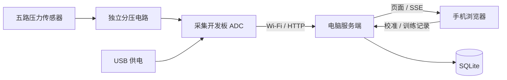
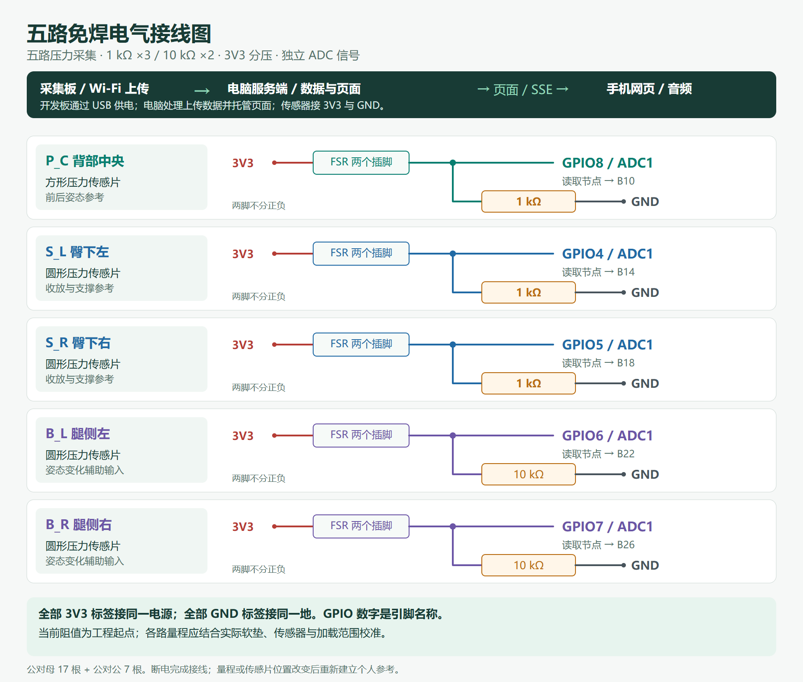
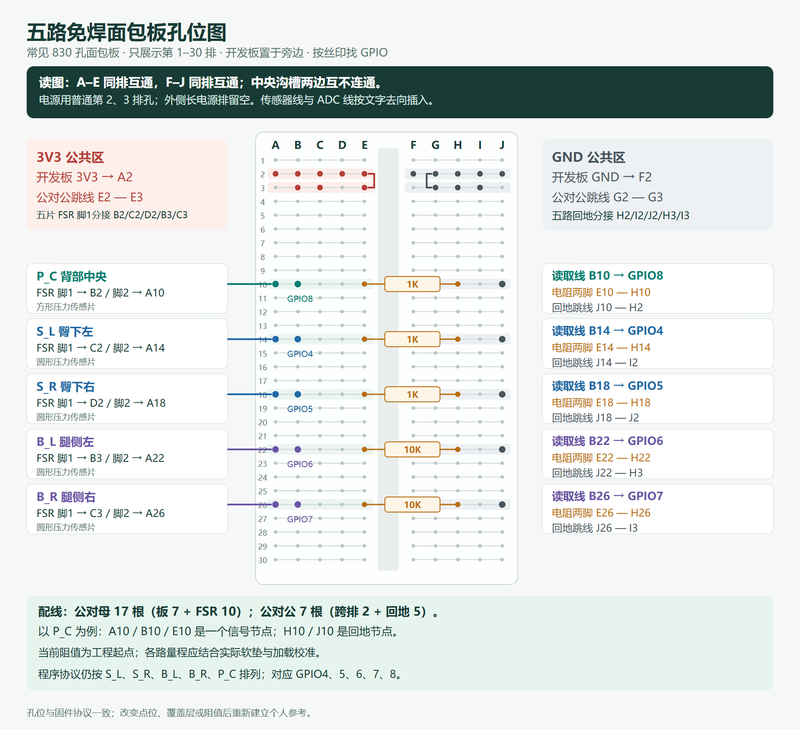

# 松弦硬件架构

## 系统组成

五片薄膜压力传感器分别连接独立分压电路，由支持 Wi-Fi 的采集开发板读取。开发板通过 USB 获得电源，以 HTTP 向同一局域网内的电脑服务端上传数据。电脑负责设备状态、个人校准、训练记录及页面托管；手机浏览器通过 SSE 接收实时数据，提供带练与反馈界面。

开发板通过 UDP 广播发现电脑服务，也支持手动设置服务器地址。Wi-Fi 凭据由配网页输入并存储在设备本地；设备上传令牌与服务端配置保持一致。

## 硬件型号与规格

| 器件           | 型号或规格                                                            | 装配数量   |
| -------------- | --------------------------------------------------------------------- | ---------- |
| 采集开发板     | ESP32-S2 Pico，ESP32-S2FN4R2，已焊排针款                              | 1 块       |
| 圆形压力传感片 | FSR402B 长尾款，总长约 56 mm，圆片外形直径约 18 mm，带金属插脚        | 4 片       |
| 方形压力传感片 | FSR406B 长尾款，总长约 83.1 mm，方片外形约 43.7 × 43.7 mm，带金属插脚 | 1 片       |
| 分压电阻       | 直插金属膜，1/2 W、±1%；1 kΩ ×3、10 kΩ ×2                             | 5 只       |
| 公对母杜邦线   | 40 cm、2.54 mm、40P 可拆排线                                          | 使用 17 根 |
| 公对公杜邦线   | 30 cm、2.54 mm、40P 可拆排线                                          | 使用 7 根  |
| 免焊面包板     | 830 孔，带背胶、可拼接                                                | 1 块       |
| USB 数据线     | 开发板配套，支持数据传输与供电                                        | 1 根       |

杜邦线、电阻和面包板以规格标识，原器件记录未提供独立品牌料号。传感器尺寸为器件外形规格；信号工作区取决于器件、软垫与加载情况，需要实测并校准。

接线图中的采集板对应 ESP32-S2 Pico，圆形压力传感片对应 FSR402B，方形压力传感片对应 FSR406B。手机和电脑仅作为浏览器终端与服务端设备，不限定具体型号。

开发板引脚资料见[ESP32-S2 Pico 厂家文档](https://wiki.nologo.tech/product/esp32/esp32s2/esp32s2pico/esp32S2Pico.html)。

## 五点布局与采集

左右以坐着的人为准。通道顺序固定为 `[S_L, S_R, B_L, B_R, P_C]`，对应 GPIO `[4, 5, 6, 7, 8]`。

| 通道 | 位置     | 传感器型号 | GPIO | 当前分压电阻 |
| ---- | -------- | ---------- | ---- | ------------ |
| S_L  | 臀下左   | FSR402B    | 4    | 1 kΩ         |
| S_R  | 臀下右   | FSR402B    | 5    | 1 kΩ         |
| B_L  | 腿侧左   | FSR402B    | 6    | 10 kΩ        |
| B_R  | 腿侧右   | FSR402B    | 7    | 10 kΩ        |
| P_C  | 背部中央 | FSR406B    | 8    | 1 kΩ         |

固件使用 12 位 ADC，以 50 Hz 采样，每五个样本组成一批。上传数据包含设备标识、启动标识、布局版本、帧序号和五路原始值。GPIO 编号指开发板引脚名称，接线按引脚丝印核对。

## 分压电路

每路采用 `3V3 → 压力传感器 → 采样节点 → 固定电阻 → GND`，采样节点接对应 GPIO。五路共用 3V3 和 GND，信号节点彼此独立。

节点电压为 `Vout = 3.3 × R固定 / (R传感器 + R固定)`。当前三路使用 1 kΩ、两路使用 10 kΩ，属于工程起点，需要结合实际软垫、传感器和加载范围分别校准，不代表最终人体标定值。

[电气接线图 SVG](assets/wiring.svg)

## 面包板孔位

同一排 A–E 五孔互通，F–J 五孔互通；中央沟槽两侧不连通。使用普通第 2、3 排作为电源与地分配区，外侧长电源排留空。

- 电源：开发板 `3V3 → A2`，跳线 `E2 ↔ E3`。
- 地：开发板 `GND → F2`，跳线 `G2 ↔ G3`。

| 通道 | 传感器供电孔 | 传感器信号孔 | ADC 读取线  | 电阻两脚   | 回地跳线  |
| ---- | ------------ | ------------ | ----------- | ---------- | --------- |
| P_C  | B2           | A10          | B10 → GPIO8 | E10 ↔ H10 | J10 ↔ H2 |
| S_L  | C2           | A14          | B14 → GPIO4 | E14 ↔ H14 | J14 ↔ I2 |
| S_R  | D2           | A18          | B18 → GPIO5 | E18 ↔ H18 | J18 ↔ J2 |
| B_L  | B3           | A22          | B22 → GPIO6 | E22 ↔ H22 | J22 ↔ H3 |
| B_R  | C3           | A26          | B26 → GPIO7 | E26 ↔ H26 | J26 ↔ I3 |

以 P_C 为例，A10、B10、E10 构成信号节点；H10、J10 构成回地节点。电阻跨越中央沟槽，将信号节点接到地。每个孔只容纳一个插脚或线头。

配线共需公对母 17 根、公对公 7 根和电阻 5 只。两根公共跳线连接分配区，其余五根公对公线负责回地。

[面包板孔位图 SVG](assets/breadboard.svg)

## 安装与校准

传感片平整安装，底部使用平整支撑，上方覆盖均匀软层；接头和控制盒置于人体承压区域之外，线缆留出缓冲。臀下两片用于联合收放参考，腿侧两片辅助观察姿态，背部中央辅助观察前后变化。自然坐姿不要求始终贴靠背部传感片。

断电完成接线并核对电源、地和各信号节点，再分别观察五路按压与松开的变化。传感片位置、覆盖层或工作阻值改变后，应重新检查量程并建立个人参考。持续饱和或接触不稳定的通道不能用于动作评价。

五路压力用于相对接触与个人模式变化的观察，不作为精确体重或肌肉力量测量。
